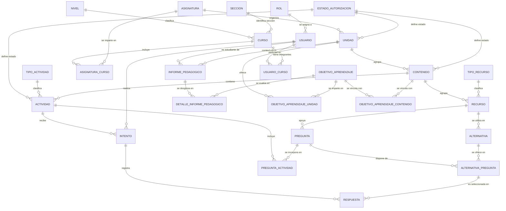

# Relaciones del modelo de datos MPAZ

**Alcance:** documentación de las relaciones definidas mediante claves foráneas y restricciones `UNIQUE` en el modelo.

**Fuentes del modelo:**
- DDL de referencia (Oracle 21c): `mpaz_modelo_refactorizado_oracle.sql`.
- Implementación en PostgreSQL: `src/main/resources/db/migration/V1__init.sql` y `V2__oa_unidad_contenido_informe.sql`.

Los nombres se muestran en mayúsculas por legibilidad; en PostgreSQL se crean en minúsculas. El modelo implementado define 26 tablas, 34 claves foráneas y 18 restricciones `UNIQUE`.

## 1. Convenciones de cardinalidad

- **1:N:** un registro de la entidad principal puede relacionarse con varios registros de la entidad dependiente. Cada registro dependiente pertenece a un único registro principal.
- **N:M:** una entidad puede relacionarse con varios registros de otra entidad, y viceversa. En el modelo se implementa mediante una tabla intermedia.
- Las FK del modelo son `NOT NULL`; por tanto, cada registro dependiente debe referenciar un registro existente.
- Las restricciones `UNIQUE` de las tablas intermedias impiden repetir una misma pareja de entidades. En `RESPUESTA`, la unicidad se aplica a la combinación de intento, pregunta y alternativa.

## 2. Diagrama general

El diagrama representa las relaciones implementadas en el SQL. Las tablas intermedias se muestran explícitamente.

## 3. Relaciones por área funcional

### 3.1. Organización académica

| Relación | Cardinalidad | Implementación | Descripción |
|---|---|---|---|
| `NIVEL` → `CURSO` | 1:N | `CURSO.nivel_id` → `NIVEL.nivel_id` | Cada curso corresponde a un nivel. Un nivel puede estar asociado a varios cursos. |
| `SECCION` → `CURSO` | 1:N | `CURSO.seccion_id` → `SECCION.seccion_id` | Cada curso tiene una sección. Una sección puede utilizarse en cursos de distintos niveles o años. |
| `CURSO` ↔ `ASIGNATURA` | N:M | `ASIGNATURA_CURSO` | Un curso puede tener varias asignaturas y una asignatura puede impartirse en varios cursos. |
| `ASIGNATURA` → `UNIDAD` | 1:N | `UNIDAD.asignatura_id` → `ASIGNATURA.asignatura_id` | Cada unidad pertenece a una asignatura. Una asignatura puede organizar varias unidades. |
| `UNIDAD` ↔ `OBJETIVO_APRENDIZAJE` | N:M | `OBJETIVO_APRENDIZAJE_UNIDAD` | Un objetivo de aprendizaje puede impartirse en varias unidades (currículum en espiral) y una unidad puede ofrecer varios objetivos. |
| `UNIDAD` → `CONTENIDO` | 1:N | `CONTENIDO.unidad_id` → `UNIDAD.unidad_id` | Cada contenido pertenece a una única unidad. Una unidad puede agrupar varios contenidos. |
| `OBJETIVO_APRENDIZAJE` ↔ `CONTENIDO` | N:M | `OBJETIVO_APRENDIZAJE_CONTENIDO` | Un objetivo puede relacionarse con varios contenidos y un contenido puede contribuir a varios objetivos. La vinculación se hace en el contexto de una unidad. |

**Restricciones relevantes:**

- `ASIGNATURA_CURSO` tiene `UNIQUE (curso_id, asignatura_id)`, por lo que una asignatura no puede repetirse dentro del mismo curso.
- `CURSO` tiene `UNIQUE (annio, nivel_id, seccion_id)`, por lo que no se puede registrar dos veces la misma combinación de año, nivel y sección.
- `SECCION.letra` es única en la tabla `SECCION`.
- `OBJETIVO_APRENDIZAJE_UNIDAD` tiene `UNIQUE (objetivo_aprendizaje_id, unidad_id)`: un OA no se repite dentro de la misma unidad.
- `OBJETIVO_APRENDIZAJE_CONTENIDO` tiene unicidad sobre la pareja `contenido_id`, `objetivo_aprendizaje_id` y guarda `unidad_id`.
- `OBJETIVO_APRENDIZAJE_CONTENIDO` usa FK compuestas contra `CONTENIDO (contenido_id, unidad_id)` y contra `OBJETIVO_APRENDIZAJE_UNIDAD (objetivo_aprendizaje_id, unidad_id)`. Así, el contenido y el OA deben pertenecer a la misma unidad.
- `CONTENIDO.unidad_id` es inmutable: un trigger `BEFORE UPDATE OF unidad_id` rechaza el cambio. Las actividades heredan la unidad del contenido y no la replican.

### 3.2. Contenidos, actividades y recursos

| Relación | Cardinalidad | Implementación | Descripción |
|---|---|---|---|
| `ESTADO_AUTORIZACION` → `CONTENIDO` | 1:N | `CONTENIDO.estado_id` → `ESTADO_AUTORIZACION.estado_id` | Cada contenido tiene un estado de autorización. Un estado puede aplicarse a muchos contenidos. |
| `ESTADO_AUTORIZACION` → `UNIDAD` | 1:N | `UNIDAD.estado_id` → `ESTADO_AUTORIZACION.estado_id` | Cada unidad tiene un estado de autorización. |
| `ESTADO_AUTORIZACION` → `ACTIVIDAD` | 1:N | `ACTIVIDAD.estado_id` → `ESTADO_AUTORIZACION.estado_id` | Cada actividad tiene un estado de autorización. |
| `TIPO_ACTIVIDAD` → `ACTIVIDAD` | 1:N | `ACTIVIDAD.tipo_actividad_id` → `TIPO_ACTIVIDAD.tipo_actividad_id` | Cada actividad pertenece a un tipo de actividad. |
| `CONTENIDO` → `ACTIVIDAD` | 1:N | `ACTIVIDAD.contenido_id` → `CONTENIDO.contenido_id` | Cada actividad está asociada a un contenido. Un contenido puede tener varias actividades. La unidad de la actividad se hereda de `CONTENIDO.unidad_id`. |
| `CONTENIDO` → `RECURSO` | 1:N | `RECURSO.contenido_id` → `CONTENIDO.contenido_id` | Cada recurso pertenece a un contenido. Un contenido puede agrupar varios recursos. |
| `TIPO_RECURSO` → `RECURSO` | 1:N | `RECURSO.tipo_recurso_id` → `TIPO_RECURSO.tipo_recurso_id` | Cada recurso tiene un tipo. Un tipo puede clasificar varios recursos. |
| `RECURSO` → `PREGUNTA` | 1:N | `PREGUNTA.recurso_id` → `RECURSO.recurso_id` | Cada pregunta referencia un recurso. Un recurso puede estar asociado a varias preguntas. |
| `RECURSO` → `ALTERNATIVA` | 1:N | `ALTERNATIVA.recurso_id` → `RECURSO.recurso_id` | Cada alternativa referencia un recurso. Un recurso puede estar asociado a varias alternativas. |

### 3.3. Actividades y preguntas

| Relación | Cardinalidad | Implementación | Descripción |
|---|---|---|---|
| `ACTIVIDAD` ↔ `PREGUNTA` | N:M | `PREGUNTA_ACTIVIDAD` | Una actividad puede incluir varias preguntas y una pregunta puede formar parte de varias actividades. |
| `PREGUNTA` ↔ `ALTERNATIVA` | N:M | `ALTERNATIVA_PREGUNTA` | Una pregunta puede disponer de varias alternativas y una alternativa puede asociarse a varias preguntas. |

**Restricciones relevantes:**

- `PREGUNTA_ACTIVIDAD` tiene `UNIQUE (actividad_id, pregunta_id)`: una pregunta no puede asociarse dos veces a la misma actividad.
- `ALTERNATIVA_PREGUNTA` tiene `UNIQUE (pregunta_id, alternativa_id)`: una alternativa no puede repetirse dentro de la misma pregunta.

### 3.4. Intentos y respuestas de estudiantes

| Relación | Cardinalidad | Implementación | Descripción |
|---|---|---|---|
| `USUARIO` → `INTENTO` | 1:N | `INTENTO.usuario_id` → `USUARIO.usuario_id` | Cada intento pertenece a un usuario. Un usuario puede realizar varios intentos. |
| `ACTIVIDAD` → `INTENTO` | 1:N | `INTENTO.actividad_id` → `ACTIVIDAD.actividad_id` | Cada intento corresponde a una actividad. Una actividad puede tener muchos intentos. |
| `INTENTO` → `RESPUESTA` | 1:N | `RESPUESTA.intento_id` → `INTENTO.intento_id` | Cada respuesta registrada pertenece a un intento. Un intento puede contener varias respuestas. |
| `ALTERNATIVA_PREGUNTA` → `RESPUESTA` | 1:N | FK compuesta `(pregunta_id, alternativa_id)` | Cada respuesta selecciona una alternativa válida para una pregunta. La misma combinación pregunta-alternativa puede ser seleccionada en distintos intentos. |

**Funcionamiento de `RESPUESTA`:**

La tabla almacena una fila por cada alternativa seleccionada por el estudiante. Sus columnas son:

- `intento_id`: identifica el intento en que se responde.
- `pregunta_id`: identifica la pregunta respondida.
- `alternativa_id`: identifica la alternativa seleccionada.

La restricción `UNIQUE (intento_id, pregunta_id, alternativa_id)` evita registrar dos veces la misma alternativa para una pregunta dentro de un mismo intento, pero permite seleccionar varias alternativas para esa pregunta. Por tanto, la estructura admite preguntas de selección única y múltiple.

La FK compuesta hacia `ALTERNATIVA_PREGUNTA (pregunta_id, alternativa_id)` garantiza que la alternativa seleccionada esté asociada a la pregunta indicada.

### 3.5. Informes pedagógicos

| Relación | Cardinalidad | Implementación | Descripción |
|---|---|---|---|
| `USUARIO` → `INFORME_PEDAGOGICO` | 1:N | `INFORME_PEDAGOGICO.usuario_id` → `USUARIO.usuario_id` | Cada informe corresponde a un estudiante (según la definición funcional acordada). Un estudiante puede tener varios informes. |
| `UNIDAD` → `INFORME_PEDAGOGICO` | 1:N | `INFORME_PEDAGOGICO.unidad_id` → `UNIDAD.unidad_id` | Cada informe se emite en el contexto de una unidad. Una unidad puede contextualizar varios informes. |
| `INFORME_PEDAGOGICO` → `DETALLE_INFORME_PEDAGOGICO` | 1:N | `DETALLE_INFORME_PEDAGOGICO.informe_pedagogico_id` → `INFORME_PEDAGOGICO.informe_pedagogico_id` | Cada detalle pertenece a un informe. Un informe puede contener resultados para varios objetivos. |
| `OBJETIVO_APRENDIZAJE` → `DETALLE_INFORME_PEDAGOGICO` | 1:N | `DETALLE_INFORME_PEDAGOGICO.objetivo_aprendizaje_id` → `OBJETIVO_APRENDIZAJE.objetivo_aprendizaje_id` | Cada detalle informa resultados de un objetivo. Un objetivo puede aparecer en distintos informes. |

En conjunto, `INFORME_PEDAGOGICO` y `OBJETIVO_APRENDIZAJE` mantienen una relación N:M resuelta mediante `DETALLE_INFORME_PEDAGOGICO`. Esta tabla almacena `correctas` e `incorrectas` para cada pareja informe-objetivo.

La restricción `UNIQUE (informe_pedagogico_id, objetivo_aprendizaje_id)` permite un solo detalle por objetivo dentro de cada informe.

`INFORME_PEDAGOGICO.unidad_id` es `NOT NULL`. El detalle no duplica la unidad: como un OA puede pertenecer a varias unidades, la coherencia entre `informe.unidad_id` y cada OA del detalle debe validarse en la capa de servicio.

### 3.6. Usuarios, roles y cursos

| Relación | Cardinalidad | Implementación | Descripción |
|---|---|---|---|
| `ROL` → `USUARIO` | 1:N | `USUARIO.rol_id` → `ROL.rol_id` | Cada usuario tiene un rol. Un rol puede estar asignado a varios usuarios. |
| `USUARIO` ↔ `CURSO` | N:M | `USUARIO_CURSO` | Un usuario puede estar asociado a varios cursos y un curso puede tener varios usuarios. |

La restricción `UNIQUE (usuario_id, curso_id)` de `USUARIO_CURSO` impide registrar dos veces al mismo usuario en el mismo curso.

## 4. Resumen de tablas intermedias

Estas tablas implementan relaciones muchos a muchos o almacenan información propia de la relación:

| Tabla intermedia | Entidades relacionadas | Atributos adicionales o restricciones |
|---|---|---|
| `ASIGNATURA_CURSO` | `ASIGNATURA` – `CURSO` | PK propia; pareja curso-asignatura única. |
| `ALTERNATIVA_PREGUNTA` | `PREGUNTA` – `ALTERNATIVA` | PK propia; pareja pregunta-alternativa única. |
| `OBJETIVO_APRENDIZAJE_UNIDAD` | `OBJETIVO_APRENDIZAJE` – `UNIDAD` | PK propia; pareja objetivo-unidad única. Permite que un OA se imparta en varias unidades. |
| `OBJETIVO_APRENDIZAJE_CONTENIDO` | `OBJETIVO_APRENDIZAJE` – `CONTENIDO` | PK propia; pareja objetivo-contenido única; guarda `unidad_id` y exige por FK compuesta que contenido y OA compartan la unidad. |
| `PREGUNTA_ACTIVIDAD` | `ACTIVIDAD` – `PREGUNTA` | PK propia; pareja actividad-pregunta única. |
| `USUARIO_CURSO` | `USUARIO` – `CURSO` | PK propia; pareja usuario-curso única. |
| `DETALLE_INFORME_PEDAGOGICO` | `INFORME_PEDAGOGICO` – `OBJETIVO_APRENDIZAJE` | PK propia; pareja informe-objetivo única; almacena correctas e incorrectas. |

`RESPUESTA` también conecta un intento con una alternativa perteneciente a una pregunta, pero es una entidad de registro de respuestas y no una tabla intermedia convencional.

## 5. Consideraciones derivadas del modelo actual

1. **Las unidades pertenecen a asignaturas, no directamente a cursos.** La relación entre curso y asignatura se realiza mediante `ASIGNATURA_CURSO`. Por ello, los cursos asociados a una misma asignatura comparten el catálogo de unidades de esa asignatura.
2. **Las actividades pertenecen a contenidos.** El SQL no define una relación directa entre actividad y curso. Los intentos sí relacionan una actividad con el usuario que la realiza.
3. **El informe pedagógico identifica al estudiante mediante `usuario_id`.** La FK comprueba que el usuario exista, pero la pertenencia al rol de estudiante debe validarse en la lógica de la aplicación.
4. **`USUARIO_CURSO` no distingue por sí sola el tipo de participación.** La tabla relaciona usuarios y cursos; el SQL no restringe esa relación a estudiantes, docentes u otro rol.
5. **`SECCION.letra` es única globalmente.** Esto permite reutilizar el registro de sección “A” en distintos cursos, años y niveles. La unicidad del curso completo se controla por `annio`, `nivel_id` y `seccion_id`.
6. **No se especifican reglas `ON DELETE` ni `ON UPDATE`.** Por tanto, se aplican los comportamientos predeterminados de PostgreSQL (`NO ACTION` en ambos casos); no se declara borrado en cascada.
7. **La unidad de una actividad se hereda del contenido.** `ACTIVIDAD` apunta a `CONTENIDO` y `CONTENIDO.unidad_id` es `NOT NULL` e inmutable. Por tanto, la unidad de la actividad es siempre `actividad.contenido.unidad_id`; no se duplica en `ACTIVIDAD`.
8. **Un OA puede pertenecer a varias unidades.** La relación N:M se resuelve en `OBJETIVO_APRENDIZAJE_UNIDAD`. Un mismo OA puede ofrecerse en varias unidades, pero solo puede vincularse a un contenido dentro de una unidad en la que esté ofrecido, gracias a la FK compuesta de `OBJETIVO_APRENDIZAJE_CONTENIDO`.
9. **El informe pedagógico está acotado por unidad.** `INFORME_PEDAGOGICO.unidad_id` es obligatorio y los OA del detalle deben pertenecer a esa unidad. Esa coherencia no puede expresarse con una FK simple porque `DETALLE_INFORME_PEDAGOGICO` no guarda `unidad_id`; se valida en el servicio.
10. **La inmutabilidad de `CONTENIDO.unidad_id` protege el historial.** Un intento o un informe pasado no cambia de unidad retroactivamente. Si se requiere mover un contenido, debe crearse uno nuevo en la unidad destino.

---

**Nota:** este documento describe las relaciones contenidas en `mpaz_modelo_refactorizado_oracle.sql` y su traducción a PostgreSQL en `V1__init.sql` y `V2__oa_unidad_contenido_informe.sql`. No incorpora relaciones hipotéticas ni reglas de negocio que no estén representadas en ese DDL, salvo las aclaraciones funcionales señaladas expresamente.
